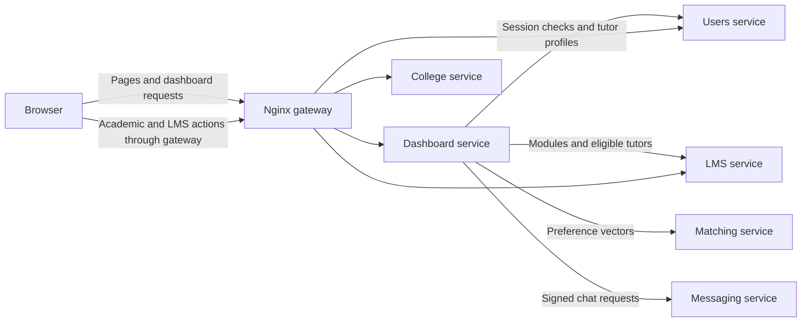

# Dashboard

The dashboard serves signed-in pages for student, tutor, lecturer and college
administrator activities. Login and registration have separate frontends.
The dashboard uses shared templates and static files, and coordinates with
backend services to display account information, tutors and messages.

## Architecture

The browser also uses shared JavaScript to call users, college and LMS APIs
through the gateway. The dashboard calls the matching service with supplied
vectors; matching does not fetch tutor profiles itself.

## Folder Structure

- `app.py` - creates the Flask app, configures shared templates and static files, and registers routes.
- `users_client.py` - checks authentication and forwards session information to upstream services.
- `messaging_client.py` - signs requests to messaging and forwards its session cookie.
- `clean_text.py` - cleans text data used by the dashboard.
- `process_preferences.py` - builds preference vectors and calls the matching service.
- `routes/` - contains route blueprints, role selection and dashboard rendering helpers.
- `templates/` - contains dashboard pages and partials.

## Templates

Files starting with `_` are partials intended for inclusion in other templates.
They are not rendered on their own.

### Base layouts

- `dashboard_base.html` - signed-in layout. It extends the shared `base.html` and adds the navigation bar (Dashboard, Messages, My account, role switcher, Sign out) and the content area that child pages fill via `dashboard_content`.

### Pages

- `student_dashboard.html` - student home ("Find your tutor"): the module list, the tutor results area, and the "Apply to be a tutor" panel with module search.
- `tutor_dashboard.html` - tutor home: welcome message and the learning and teaching preference summaries.
- `admin_dashboard.html` - college admin home: academic management, CSV upload, LMS connection settings, imported LMS data and the pending tutor applications review list.
- `lecturer_dashboard.html` - assigned teaching modules and tutor application reviews.
- `lecturer_applications.html` - tutor application review page.
- `account.html` - account details (username, email) and links to set up or edit learning preferences, plus teaching preferences for tutors.
- `preferences.html` - one form for learning or teaching preference ratings (0-10 for each of the four styles). The `type` query value selects which kind it edits.
- `choose_username.html` - first-time username selection form.
- `messaging.html` - messaging page extending `dashboard_base.html`: chat list sidebar, conversation area, and message input. It opens a particular chat on load when the `openChat` parameter is set.

### Partials

- `_preferences_summary.html` - read-only list of a user's learning or teaching scores with an edit link. Used by `tutor_dashboard.html`.
- `_academic_management.html` - admin forms to create courses and modules and assign users, with lists of existing courses, modules, assignments and the CSV directory.
- `_csv_upload.html` - admin CSV upload forms for modules and users, with a preview table.
- `_lms_settings.html` - admin form to save the college's LMS connection and run a sync.
- `_lms_imported_data.html` - admin table of the data imported from the LMS.
- `_tutor_reviews.html` - tutor application review controls used by lecturer pages.
- `_lms_profile.html` - LMS profile information partial; no current dashboard template includes it.

## Routes

Routes and rendering helpers live in `routes/`. `routes/__init__.py` registers
the route blueprints on the app. Dashboard routes use `@login_required` from
`users_client.py`, which redirects signed-out visitors to `/login`.

- `auth.py` - onboarding step `/choose-username`.
- `account.py` - `/account` and `/preferences` (`?type=learning` or `?type=teaching`). Also holds `can_manage_college`, the check for admins who have a college.
- `dashboard.py` - `/dashboard` entry point, `/admin-dashboard`, `/lecturer-dashboard`, `/tutor-applications` and `POST /dashboard/switch/<role>`. The main entry point handles username and tutor preference onboarding, then selects the tutor, student or admin view. College admins can access `/admin-dashboard`; users with both student and tutor roles can switch between them.
- `student.py` - student view and `/get_tutors`, which fetches eligible tutors for a module, attaches matching scores and sorts the results.
- `tutor.py` - tutor view, plus `is_tutor` and `needs_teaching_preferences`. It defines no routes; `dashboard.py` and `account.py` call it.
- `admin.py` - college admin view. It defines no routes; `dashboard.py` calls it.
- `lecturer.py` - loads teaching modules and renders the lecturer dashboard. It defines no routes; `dashboard.py` and `student.py` call it.
- `roles.py` - selects the active student or tutor role and determines which roles can be switched.
- `messaging.py` - `/messages` (chat list) and `/getmessages` (opens or creates a chat with another user).

## Tutor matching

For `/get_tutors`, the dashboard obtains eligible tutor IDs from the LMS
service and their profiles from the users service. It aligns the student's
learning preferences and tutors' teaching preferences by sorted key, using
zero for missing values, then sends the vectors to the matching service.
Returned scores are attached to profiles and sorted highest first. For handled
matching failures, the dashboard logs the failure and returns tutors without scores.
See [Matching system](matching-system.md) for the ranking algorithm and API.

Shared JavaScript is stored in `frontend_shared/static/`.
