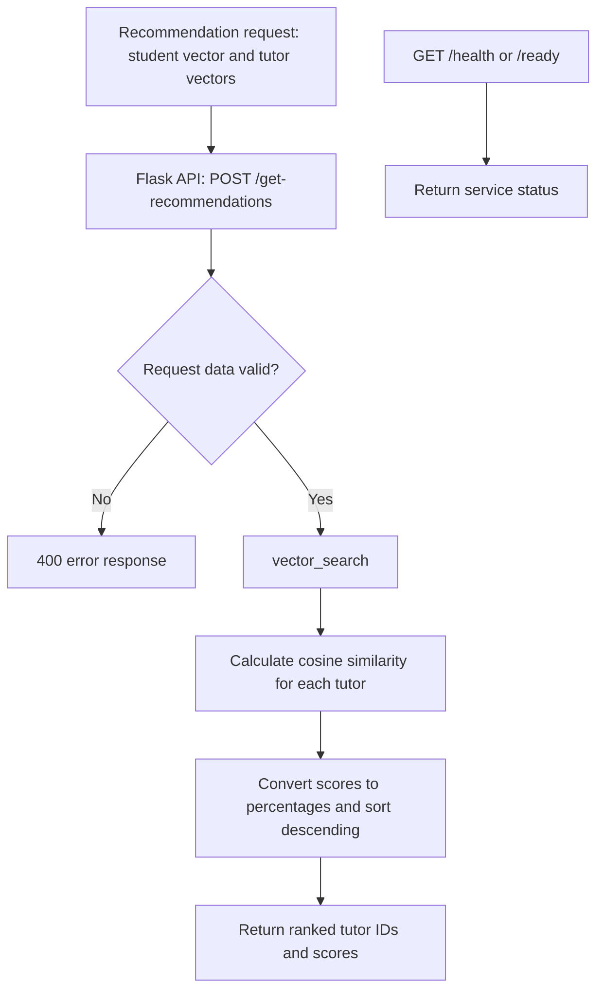

# Matching System

The matching service recommends tutors whose preference vectors are most
similar to a student's preference vector.

## How matching works

1. A student's preferences are represented as a list of numbers.
2. Each tutor has a preference vector with the same number of values.
3. The service calculates cosine similarity between the student and each tutor.
4. Results are converted to percentage-style scores, sorted from highest to
   lowest, and returned to the caller.

The preference values currently use a scale from 1 to 10. The higher the score, the higher the prefrence.
Cosine similarity compares the direction of two vectors rather than their
absolute size. This makes it suitable for comparing preference patterns.

## API

### Get tutor recommendations

```http
GET /get-recommendations
Content-Type: application/json
```

Request body:

```json
{
  "student_vector": [5, 4, 2, 5, 5],
  "tutors": {
    "user1": [4, 5, 2, 4, 5],
    "user2": [1, 1, 5, 2, 1],
    "user3": [5, 3, 3, 5, 4]
  }
}
```

The `student_vector` must be a list. The `tutors` value must be an object(dict)
mapping tutor IDs to lists. Every tutor vector must have the same length as the student vector they are getting compares with.

Example response:

```json
[
  {
    "tutor_id": "user1",
    "similarity": 99
  },
  {
    "tutor_id": "user3",
    "similarity": 98
  }
]
```

The service returns all tutors, sorted by similarity from highest similarity to lowest. This can be changed by setting `top_k` to the number of tutors to be returned.

### Health checks

```http
GET /health
```

```json
{
  "status": "healthy"
}
```

```http
GET /ready
```

```json
{
  "status": "ready"
}
```

## Errors

The service returns `400` when required data is missing or has the wrong
format. Examples include:

```json
{
  "error": "Missing student_vector in request body"
}
```

Unexpected errors return status `500` with an error message.

## Architecture diagram



The service ranks only the vectors supplied in each request. It does not retrieve
or persist preference data.
