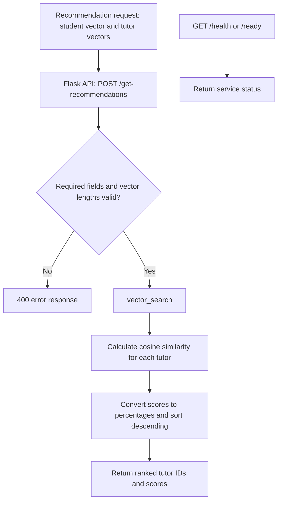

# Matching System

The matching service recommends tutors whose preference vectors are most
similar to a student's preference vector.

## Folder structure

- `app.py` - Flask application and recommendation, health and readiness endpoints.
- `vector_search.py` - cosine similarity calculation and candidate ranking.
- `tests/` - tests for the matching algorithm and vector search.

## How matching works

1. A student's preferences are represented as a list of numbers.
2. Each tutor has a preference vector with the same number of values.
3. The service calculates cosine similarity between the student and each tutor.
4. Results are converted to percentage-style scores, sorted from highest to
   lowest, and returned to the caller.

The dashboard uses a scale from 0 to 10 for preference values. The higher the
score, the stronger the preference.
Cosine similarity compares the direction of two vectors rather than their
absolute size. This makes it suitable for comparing preference patterns.

## API

### Get tutor recommendations

```http
POST /get-recommendations
Content-Type: application/json
```

Request body:

```json
{
  "student_vector": [5, 4, 2, 5, 5],
  "tutors": {
    "user1": [4, 5, 2, 4, 5],
    "user2": [1, 1, 5, 2, 1],
    "user3": [5, 3, 3, 5, 4]
  }
}
```

The `student_vector` must be a list of numbers. The `tutors` value must be an
object mapping tutor IDs to lists of numbers. Every tutor vector must have the
same length as the student vector.

Example response:

```json
[
  ["user3", 99],
  ["user1", 98],
  ["user2", 62]
]
```

Each pair contains a tutor ID and a rounded similarity score. The endpoint
returns all tutors sorted by similarity from highest to lowest. The
`vector_search` function supports `top_k`, but the API does not expose it.

### Health checks

```http
GET /health
```

```json
{
  "status": "healthy"
}
```

```http
GET /ready
```

```json
{
  "status": "ready"
}
```

## Errors

The service returns `400` when required fields are missing, have the wrong
container type, or have mismatched vector lengths. For example:

```json
{
  "error": "Missing student_vector in request body"
}
```

Unexpected errors return status `500` with an error message.

## Architecture diagram



The service ranks only the vectors supplied in each request. It does not retrieve
or persist preference data.
