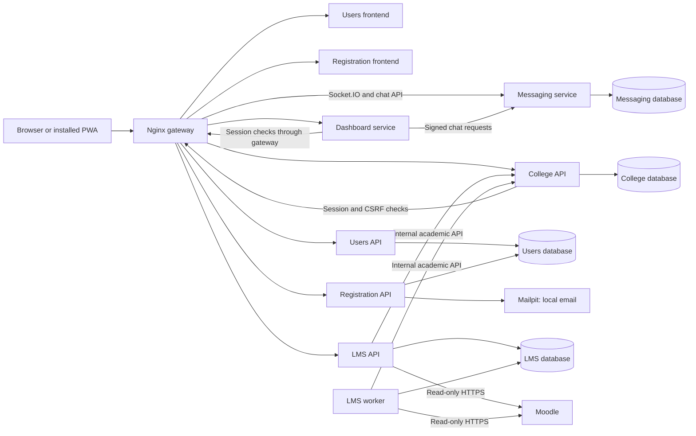
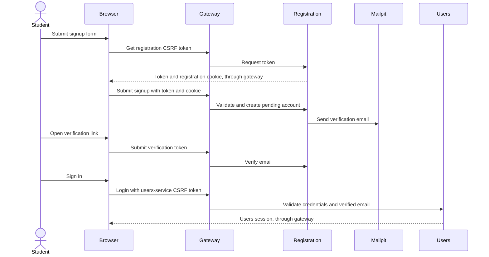

# Architecture overview

The prototype uses Flask services behind an Nginx gateway. The browser opens one origin, and Nginx sends each page or API request to the service that handles it. Frontend templates share CSS and JavaScript from `frontend_shared.`

This diagram follows `docker-compose.yml` and `nginx/default.conf`. It shows the current connections, not planned services.

The diagram omits individual route prefixes for readability. See the API overview and the gateway configuration for these routes.

## Service responsibilities

| Service | Responsibility | Storage or Dependency |
| --- | --- | --- |
| Users frontend | Sign-in page | Users API |
| Registration frontend | Signup, email verification and college registration pages | Registration and college APIs |
| Dashboard | Signed-in pages, account forms, tutor lookup and messaging hand-off | Users, college, LMS and messaging APIs |
| Users API | Login, sessions, usernames and preference scores | Users database |
| Registration API | Signup and email verification | Users database and Mailpit |
| College API | College ownership, courses, modules and manual assignments | College database |
| LMS API and worker | Connections, imports, scheduled syncs and module participation | LMS database, college API and Moodle |
| Messaging | Stored chats, messages, read state and [Socket.IO](http://Socket.IO) delivery | Messaging database |
| Matching | Standalone preference-vector ranking endpoint | Supplied vectors |

## Registration flow

## Permissions and data ownership

The users API is the source of the signed-in account's identity. College and LMS routes check the session and CSRF token through that service. College ownership and module membership checks happen in the service that owns the records.

The college service owns academic courses and modules. The LMS service stores imported profiles and references to academic catalogues, plus module memberships and tutor applications. It accesses college records through an authenticated internal API rather than reading the college database directly.

The dashboard signs backend requests to messaging with `DASHBOARD_SHARED_SECRET`. Messaging uses its own session cookie and checks that a user belongs to the chat.
